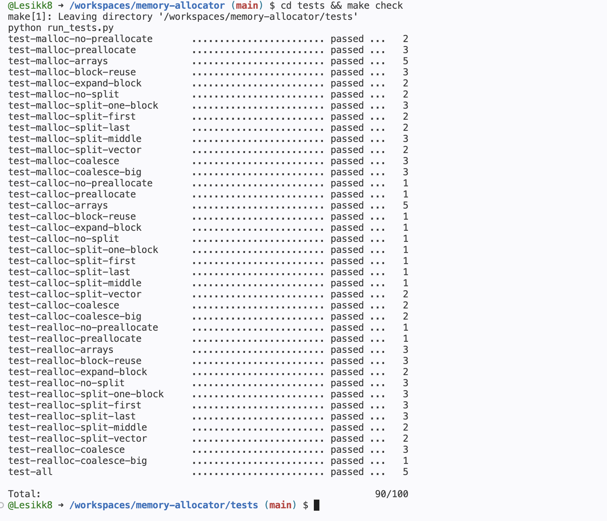

# Memory Allocator — власний алокатор пам'яті на C

**Виконала:** Певна Олеся, група ТК-41

Реалізація мінімального алокатора пам'яті (`os_malloc`, `os_calloc`, `os_realloc`, `os_free`)
за завданням [open-education-hub/operating-systems — memory-allocator](https://github.com/open-education-hub/operating-systems/tree/main/content/assignments/memory-allocator).
Повний текст завдання — у файлі [`ASSIGNMENT.md`](ASSIGNMENT.md).

Весь мій код — у файлі [`src/osmem.c`](src/osmem.c).

## Результат тестів

Усі 40 тестів проходять, перевірка на витоки пам'яті (valgrind) — без помилок:

```
Total:                                                            90/100
```

(90 — максимум автоматичної перевірки; решта балів у оригінальному курсі — за стиль коду.)

Скріншоти запуску тестів — у папці [`screenshots/`](screenshots/).

## Як запустити

Потрібен Linux (тести використовують `brk()`, `mmap()` і `ltrace`).

```bash
sudo apt-get install -y gcc make python3 ltrace valgrind
cd tests
make check
```

## Як це працює

### Блок пам'яті

Кожен блок складається із заголовка `struct block_meta` (32 байти) і корисних даних (payload).
Функції повертають адресу payload, а не заголовка. Розміри вирівнюються на 8 байтів (`ALIGN`).

```c
struct block_meta {
	size_t size;               // розмір payload
	int status;                // STATUS_FREE / STATUS_ALLOC / STATUS_MAPPED
	struct block_meta *prev;
	struct block_meta *next;
};
```

Блоки купи зберігаються у двозв'язному списку `heap_head ... heap_tail` у тому порядку, в якому лежать у пам'яті.

### Звідки береться пам'ять

| Функція | `brk()` (купа), якщо `заголовок + розмір` … | інакше `mmap()` |
|---|---|---|
| `os_malloc`, `os_realloc` | < `MMAP_THRESHOLD` (128 KB) | ≥ 128 KB |
| `os_calloc` | < розмір сторінки (4 KB) | ≥ 4 KB |

### Основні прийоми

- **Heap preallocation.** При першому використанні купи одразу виділяється 128 KB одним вільним блоком — це зменшує кількість викликів `brk()`.
- **Find best.** Серед вільних блоків обирається найменший, у який вміщається запит.
- **Split block.** Якщо після виділення в блоці лишається місце для нового заголовка + хоча б 8 байтів, залишок стає окремим вільним блоком.
- **Coalesce.** Перед пошуком усі сусідні вільні блоки об'єднуються в один.
- **Розширення останнього блока.** Якщо підходящого вільного блока немає, але останній блок купи вільний — купа збільшується рівно на нестачу, і цей блок використовується.
- **`os_free`.** Блоки з `mmap` повертаються ОС через `munmap()`. Блоки купи лише позначаються вільними (без `brk()`), щоб використати їх повторно.

### `os_realloc` по кроках

1. `ptr == NULL` → те саме, що `os_malloc(size)`; `size == 0` → те саме, що `os_free(ptr)`.
2. Блок уже звільнений → повертає `NULL`.
3. Блок з `mmap` або новий розмір ≥ 128 KB → новий блок, копіювання даних, звільнення старого.
4. Новий розмір менший → блок обрізається на місці (split).
5. Блок останній на купі → купа розширюється на нестачу, дані не переносяться.
6. Наступні вільні блоки приєднуються по одному, з перевіркою після кожного, чи вже вистачає місця.
7. Не вийшло → новий блок, копіювання, звільнення старого.

Кожен системний виклик перевіряється на помилку макросом `DIE()`.

## Скріншот запуску тестів


